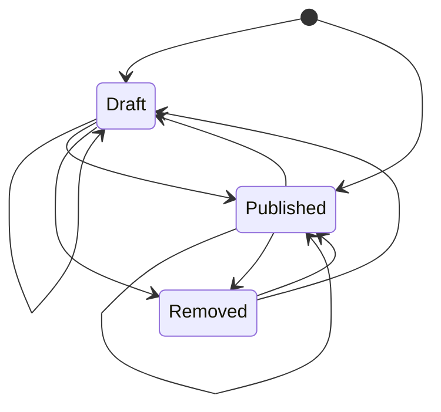
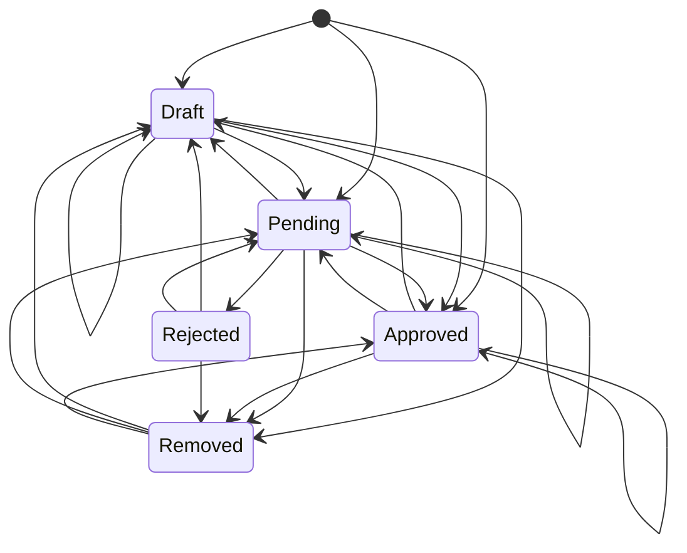
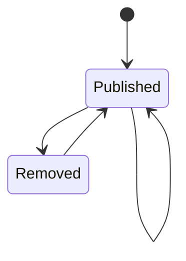

# Versioned Data and Concurrency Control

Tech Stream Conference website · FastAPI + PostgreSQL

## Scope

This document describes:

- how we store data that changes over time (versioned entities),
- how approval workflows work,
- how we protect shared data when several people change it at the same time,
- how the audit trail comes from the revisions.

It applies to every feature that stores shared data.

`roles-and-permissions-design.md` builds on this document. It defines the locks that protect changes of permissions.

## 1. Decisions

| Topic | Decision |
| --- | --- |
| Versioned entities | Each entity has an identity table and a revision table. We only add rows to the revision table. Every change of content or state adds a new revision (section 2). |
| Workflows | Each entity uses one of a few workflows. A workflow defines the states, the allowed changes between states, and which states are public (section 3). |
| Views | Each entity gets two views: a default view and a history view. We write special queries by hand (section 4). |
| Definition | We define each entity once in Python. The code creates the tables, constraints, indexes, views and workflow rules from this definition. Alembic still runs the migrations (section 5). |
| Concurrency | Every change of shared data sends a version token in `If-Match`. The backend first takes the locks, then checks the permission and the token, and then writes the change (section 7). |
| Audit trail | The revision history is the audit trail. We don't need separate audit tables (section 8). |

## 2. Versioned entities

Each versioned entity has two tables:

- The *identity table* (`talk_identities`) stores what never changes about an entity: its ID and, if it has one, its natural key. For example, the natural key of an event contributor is the user, the event and the kind.
- The *revision table* (`talk_revisions`) stores the complete state of the entity for each revision. Its primary key is the identity ID plus the revision number.

Each revision contains:

- the identity ID and the revision number,
- all data of the entity,
- the workflow state (`state`),
- the action (`action`), such as `created`, `edited`, `submitted`, `approved`, `rejected`, `withdrawn` or `removed`,
- the user who made the change (`created_by`, references `users`). It is NULL if a seeder or another automatic process made the change,
- the time of the change (`created_at`).

Rules:

- We only add revisions. We never change or delete them. The only exception is anonymizing personal data after an erasure request (section 8). Every change of content and every change of state adds a new revision, even if the data stays the same. A change of state copies the data of the previous revision, including its child rows, such as translations.
- An edit that changes neither the data (including child rows) nor the state does not add a revision. The backend compares the edit with the latest revision. If nothing changed, it returns the current state with the same `ETag` (section 7). Without this check, saving a form without changes, or sending the same data twice, would add copies to the history. It would also increase the token and cause conflicts for other users. The frontend can't prevent this, because the backend can't rely on its clients. The comparison uses normalized values, so a different order of child rows is not a change. The backend only compares with the latest revision, so going back to the content of an older revision is a real change.
- A database trigger rejects `UPDATE` and `DELETE` on revision tables. The anonymization after an erasure request bypasses it on purpose (section 8).
- Revision numbers count up per entity and start at 1. We never reuse them.
- The identity table does not point to the current revision. Queries find the current state (section 4).
- Sometimes the identity is already a row in another table, such as a user or an account. In that case, we don't create an identity table. The revisions point to that row directly.
- Some tables only get new rows but are not versioned entities, such as the table that marks registration tokens as used. They also get the trigger that rejects `UPDATE` and `DELETE`.

### Translations and other child tables

We store translated content per revision. A translation table is a child of the revision table. Its primary key is the identity ID, the revision and the language tag. A composite foreign key points to the revision table. Other child tables, such as the speakers of a talk, work the same way.

- Every new revision contains all child rows. We copy the rows that didn't change. So a revision is always a complete snapshot of the content in all languages, and one request writes one revision for all languages.
- The token of such content (section 7) is the latest revision number. If two people change different languages at the same time, the changes conflict, and the second person has to reload.
- We check rules about the whole set on the complete set of the new revision. An example is "every supported display language is present".

Here is an example for events. The existing `events` table becomes `event_identities`, and everything that can change moves to the revisions:

```text
event_identities      id PK
event_revisions       event_id, revision (PK), dates, URLs, visibility dates,
                      state, action, created_at, created_by
event_translations    event_id, revision, language_tag (PK), translated fields
                      FK (event_id, revision) -> event_revisions
                      FK language_tag -> content_languages.tag
```

Events keep their current behavior and use the workflow `AUTO_PUBLISH`. Other tables point to `event_identities.id`, which never changes. Global values and static pages will work the same way. Their identity is the `GlobalKey` or the page kind. They are still changed in place (section 8). We choose their workflow when we turn them into versioned entities.

## 3. Workflows

Each versioned entity uses one of these workflows:

| Workflow | States | Public states | Purpose |
| --- | --- | --- | --- |
| `DRAFT_AND_PUBLISH` | `Draft`, `Published`, `Removed` | `Published` | Admins can prepare drafts and publish them when they are ready. |
| `REVIEW_AND_APPROVE` | `Draft`, `Pending`, `Approved`, `Rejected`, `Removed` | `Approved` | Someone has to approve a change before it becomes public. |
| `AUTO_PUBLISH` | `Published`, `Removed` | `Published` | Every change is public right away. |

Every workflow has the state `Removed`. A removed entity is not in the default view. A later revision can bring it back.

These diagrams show the allowed changes of state. The start point stands for the first revision of an entity. An arrow from a state back to itself means that a new revision may keep the state, for example to change the content.

`DRAFT_AND_PUBLISH`:



`REVIEW_AND_APPROVE`:



`AUTO_PUBLISH`:



- A workflow only defines which changes of state exist. Each feature decides who may make them. For example, only admins may add an `Approved` revision that doesn't come from `Pending`.
- A newer revision in the state `Draft`, `Pending` or `Rejected` doesn't replace the last public revision.
- We can add more workflows later without changing the architecture. A workflow is just a set of states, allowed changes and public states.

## 4. Views

Each entity gets two generated views:

| View | Content |
| --- | --- |
| Default view (`talks`) | For each entity, the latest revision in a public state. If a newer revision is `Removed`, the entity is not shown. |
| History view (`talk_history`) | All revisions. |

We write special queries by hand as query helpers in the module of the feature. An example is "all pending revisions that are newer than the last approved revision". We don't generate views for them.

We don't generate a view of the latest revision in any state. It would also contain `Removed` revisions, so it would not fit most uses, such as an edit form that shows the latest `Pending` or `Approved` revision. Such uses get their own query helpers.

Routes read data only through the views and query helpers. They never read a revision table directly. A test checks this.

## 5. Definition in Python and migrations

Each versioned entity has one definition in Python. It describes the fields and the workflow:

```python
class TalkFields(BaseModel):
    title: Annotated[str, StringConstraints(max_length=200)]
    description: str


talk: Final = VersionedEntity(
    name="talk",
    workflow=Workflow.REVIEW_AND_APPROVE,
    fields=TalkFields,
)
```

The fields are a Pydantic model, so they are typed. The code derives the column types from the field types and their constraints. For example, a `str` with a maximum length becomes a `VARCHAR` with that length, and a `str` without one becomes `TEXT`.

The entity name is singular. Table and view names are plural, like all our other tables: `talk_identities`, `talk_revisions`, `talks` and `talk_history`. If adding an "s" doesn't give the right plural, the definition can set the plural.

Besides the fields and the workflow, a definition can:

- use an existing table as the identity (section 2), or set the natural key of the generated identity table,
- define child tables, such as translations,
- add constraints and columns that only this entity needs, such as `change_id` (section 7).

From the definition, the code creates:

- the identity table and the revision table as SQLAlchemy tables,
- their constraints and indexes, including the trigger that rejects `UPDATE` and `DELETE`,
- the check that compares an edit with the latest revision (section 2),
- the two views of section 4,
- a query helper that returns the latest revision number, which is the version token (section 7),
- the workflow rules: the allowed changes of state and the public states.

Alembic still runs the migrations. An existing extension, such as `sqlalchemy-declarative-extensions`, adds migration support for views, so autogenerate notices when a view changes. Our own code stays small and only generates the schema. It is not a migration framework.

## 6. Design principles

1. One source of truth: we define the structure and the workflow of an entity once, in Python.
2. History never changes: we never change a revision after we created it.
3. Built-in audit trail: changes of content and changes of state are both stored as revisions.
4. No duplicate data: queries find the current public revision. We don't store it separately.
5. Easy to extend: we can configure workflows and entity definitions.
6. Clear responsibilities: we generate the common views, and special queries stay in the features.

## 7. Concurrency control

Several people can change the same data. For example, two admins edit the same event, or two owners demote each other. So every change of shared data has to prove that it is based on the current state.

### Version tokens

Tokens are integers. All features use the same rules:

- For one entity, the token is the number of its latest revision, in any state. This covers its child rows, because they belong to the same revision. A change of state is also a change, so it needs the token, too.
- Sometimes we protect a whole group of rows together. Then the token is the highest `change_id` of these rows. A table that needs such a token has a `change_id` column that gets its values from a sequence. Because we only add rows, we never update a counter. For example, the version of the list of administrators is the highest `change_id` in `administrator_revisions`.
- The token goes into the `ETag` response header as an integer in quotes. It only shows how many changes there were.

### Protocol

1. When the backend returns data that a user can change, it sends the token in the `ETag` response header.
2. A change request (`PUT`, `PATCH` or `DELETE`) sends the token back in the `If-Match` request header. If the header is missing, the backend answers with `428 Precondition Required`.
3. The token covers everything the change depends on, not only the changed data. For the list of owners, it is the version of the whole list of administrators.
4. The backend runs the change in one transaction, in this order: take the locks, check the permission, compare the token, write the change.
5. If the state has changed in the meantime, the backend rolls back the transaction. It answers with `412 Precondition Failed` and a versioned error response. The frontend tells the user that someone else changed the data, and asks them to reload and make their change again.

Settings of a single user are not protected, because sending them twice has the same result. Examples are the display language, the preferences and the decisions about regional settings. The last write wins.

### Checking permissions inside the transaction

A FastAPI dependency may reject requests early if they are clearly not allowed. But for a change, the backend doesn't trust this result, because another change could remove the permission between the check and the write.

So every change that needs a permission takes the lock that protects changes of this permission, and checks the permission while it holds the lock. Each feature defines its locks and the order in which it takes them, so that no deadlocks happen. `roles-and-permissions-design.md` defines the locks for roles and permissions.

### Creating new entities

You can't lock a row that doesn't exist yet. So creating something needs a lock on something that already exists:

- We create a new identity with `INSERT ... ON CONFLICT DO NOTHING` and its unique natural key. Then the transaction locks that row and adds the revision. If two requests create the same entity at the same time, the second one waits and then sees the first one. For example, a new event contributor uses the unique key (user, event, kind) of `event_contributor_identities`.
- If the identity is a row in another table, the transaction locks that row, or takes the lock that the feature defines for it.
- The primary key of each revision table is the last protection. Two inserts with the same revision number can't both succeed.

### Why we don't rely on isolation levels

PostgreSQL uses MVCC (multi-version concurrency control: reading and writing happen in parallel on different versions of a row). Its stricter isolation levels (`REPEATABLE READ`, `SERIALIZABLE`) with retries could protect the "compare the token and write" step without explicit locks. But they can't cover the time between reading and changing the data, because the user works on the data across several HTTP requests. So they could only add to the tokens, not replace them. Their main benefit would be better performance under many concurrent changes. We don't expect much traffic, so the explicit locks are good enough, and they are easier to understand.

## 8. Audit trail

The revision history is the audit trail. Every revision stores the action, the user and the time. Changes of content and changes of state are stored the same way. We don't need separate audit tables or approval tables.

- Some data is still changed in place. Our goal is to move it to versioned entities, so that we can always see the full changes and who made them. Until then, these places still change data in place: `users.label`, sessions, user preferences, events, translations, global values and static pages.
- After an erasure request, we anonymize personal data enough that nobody can identify the person by combining other data. This is the only case where we change revisions.

### Bypassing the trigger

The trigger function lets a change through only if the transaction sets a flag. The flag is the custom setting `app.allow_revision_changes`:

```sql
IF current_setting('app.allow_revision_changes', true) = 'on' THEN
    RETURN CASE TG_OP WHEN 'DELETE' THEN OLD ELSE NEW END;
END IF;
RAISE EXCEPTION 'Revisions are append-only';
```

The anonymization sets the flag at the start of its transaction, with `SELECT set_config('app.allow_revision_changes', 'on', true)`. The third argument makes it transaction-local, like `SET LOCAL`. SQLAlchemy runs this on the same session as the changes, so it works with the ORM.

- The flag ends with the transaction. Another request on the same pooled connection does not see it, also behind PgBouncer in transaction mode.
- After a custom setting was set once, PostgreSQL returns an empty string instead of NULL for it on that connection. So the trigger compares with `= 'on'` and never relies on NULL.
- Only the anonymization code sets the flag. A test checks that all other code paths still fail.
- This protects against mistakes, not against attackers. Every database role that can write can also set the flag.

We don't use these alternatives:

- `session_replication_role = replica` needs superuser rights. It also switches off foreign key checks and all other triggers.
- `ALTER TABLE ... DISABLE TRIGGER` is a schema change. It takes a lock that blocks concurrent writes to the table.

## 9. Follow-up work

- Epics: optimistic concurrency, and audit trail. The audit trail epic covers the code of section 5 and moving the remaining data that is changed in place to versioned entities.
- Add the `If-Match` requirement to the acceptance criteria of the routes that change events and global values.
